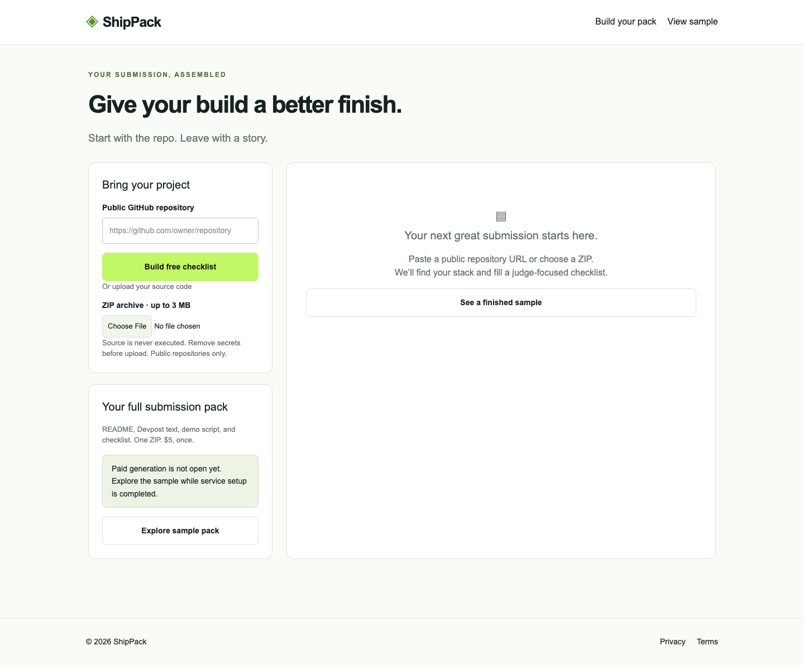
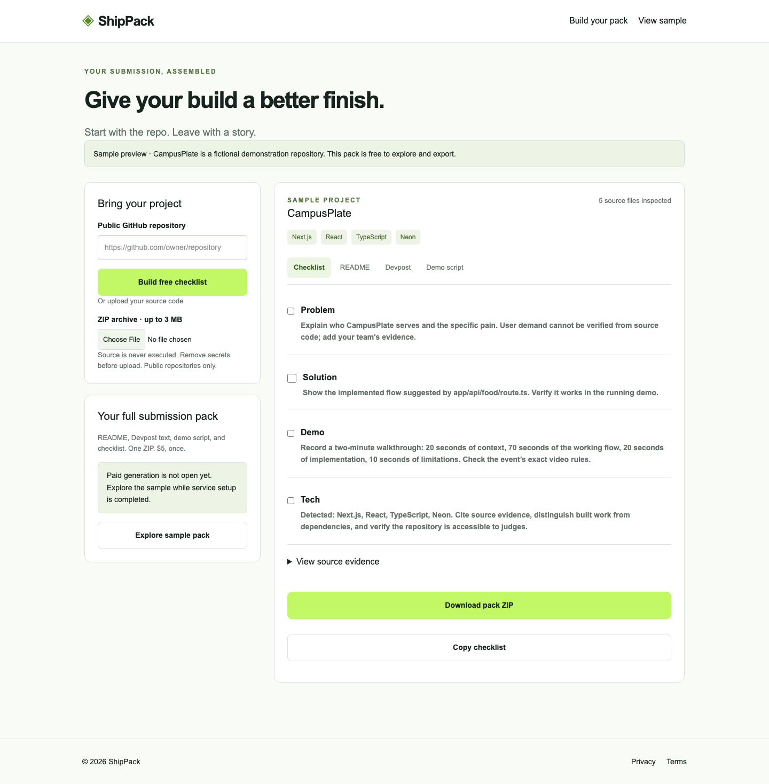
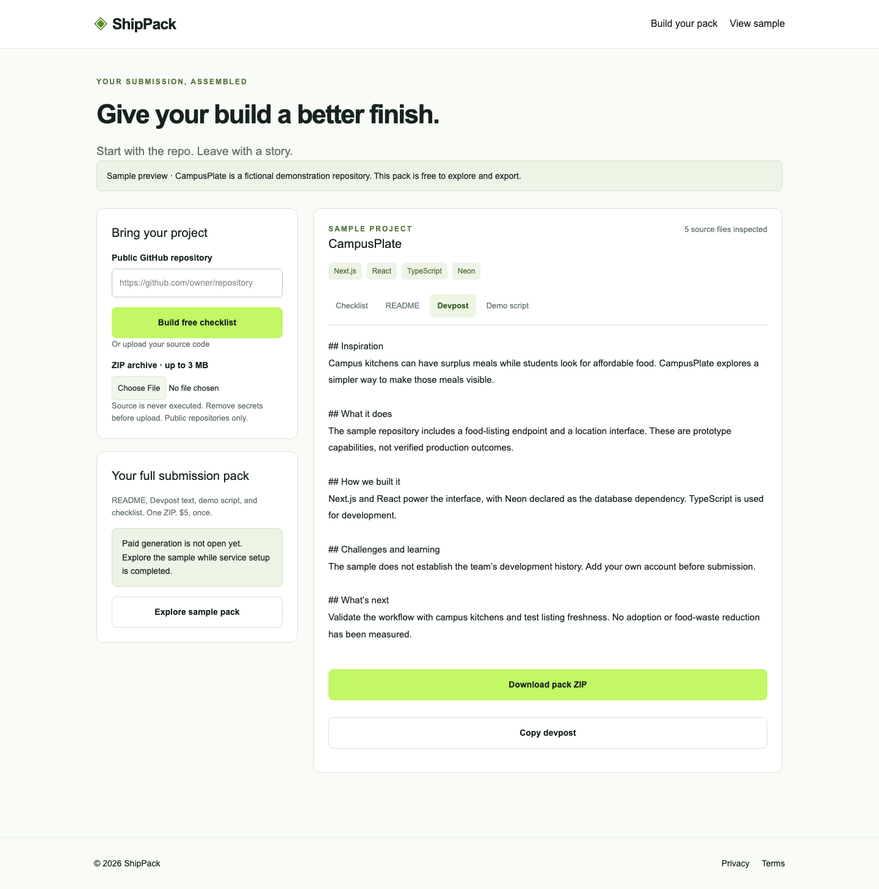
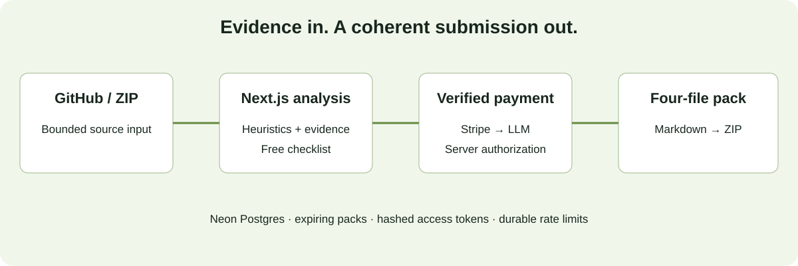
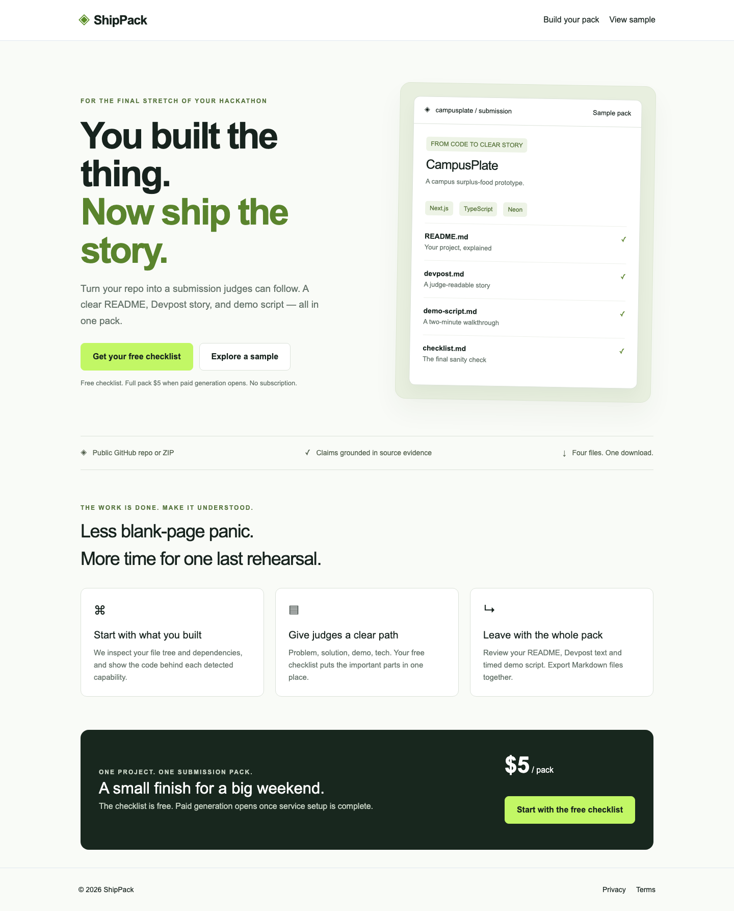
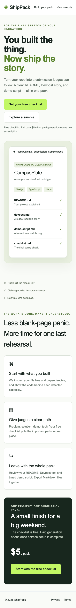
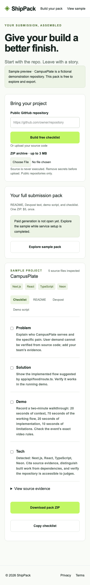

<p align="center"></p>
<p align="center">An evidence-grounded submission pack for the last hours of a hackathon.</p>
<p align="center"><a href="https://nextjs.org"></a> <a href="LICENSE"></a> <a href="package.json"></a> <a href="https://shippack-zeta.vercel.app"></a></p>

## The problem

The last-hour builder’s job sounds like this: “The app works. Now I have to explain it, fill the submission form, and rehearse the demo.” This is our target workflow, not a customer testimonial. Code alone does not give judges a clear story.

## How we felt it

The concrete workflow behind ShipPack is switching between a repository, a blank README, Devpost’s submission fields, and a demo outline while a deadline approaches. We built around that handoff. We are not claiming a founder interview, hackathon win, or measured time saving.

## What we built

### Bring the build

Paste a public GitHub URL or upload a source ZIP. The analyzer reads a bounded file tree and manifests, detects stack, and shows evidence paths. It never executes uploaded code.



### Give judges a path

A free checklist covers problem, solution, demo and technology. It tells you which claims code supports and which require team confirmation.



### Make the submission consistent

README, Devpost text, a timed two-minute demo storyboard and checklist use the same evidence. A labeled CampusPlate sample is fully explorable. Live paid writing requires OpenAI and Stripe keys and remains closed until they are configured and verified.



### Take the whole pack

One click exports four Markdown files as a ZIP. Sample export is free; real generated artifacts require server-verified payment of USD 5.


## How it works



1. A public GitHub URL is constrained to owner/repository; uploads have compressed and expanded size limits.
2. Heuristics inspect manifests and source paths, returning evidence rather than claiming runtime success.
3. Neon holds seven-day pack records and hashed browser access tokens; rate limits use atomic shared storage.
4. Stripe payment is retrieved server-side and bound to the owned pack before any model request.
5. The model returns four validated text artifacts; authenticated export creates the ZIP on demand.

## Quickstart

Node 22.13+ and npm are required. From this repository:

```sh
npm ci
npm run dev
```

The sample works without credentials at http://localhost:3000/pack?sample=1. Real analysis needs `DATABASE_URL` in `.env.local`; apply `node --env-file=.env.local scripts/migrate.mjs` after Neon setup. Paid generation additionally needs `OPENAI_API_KEY` and `STRIPE_SECRET_KEY`. Use Stripe test mode before enabling live sales. See [deployment and blockers](LAUNCH.md).

## Screenshots

Real Playwright captures, not mockups. Regenerate with `npm run build && npm run shots` (the test runner starts production on port 4317). To include the live database integration test, use `node --env-file=.env.local node_modules/@playwright/test/cli.js test`.

| Desktop | Mobile |
| --- | --- |
|  |  |
|  |  |

## Demo video

[](docs/demo.mp4)

[Play the MP4](docs/demo.mp4). Real browser recording with speech narration and large captions, showing the labeled sample rather than an unverified purchase. [Storyline](docs/demo-story.md) · [Recording script](scripts/record-demo.mjs).

## Why this is interesting

- **Evidence before persuasion.** File paths are retained, but source inspection cannot prove that a feature works. Drafts explicitly distinguish those limits.
- **Payment authority stays on the server.** Redirect parameters never unlock a pack. Stripe session ownership, currency and amount must match before generation.
- **A small, bounded trust surface.** No repository execution, no extracted filesystem paths, no team accounts. This limits capability but keeps the final-hour workflow understandable.

## Validation and release status

See [security audit](docs/security-audit.md) and [launch record](LAUNCH.md) for actual checks and remaining limitations. A preview is not a completed paid launch. The animated header uses a committed SMIL SVG with a readable static fallback; motion is disabled by some viewers and GitHub renderer verification remains pending while the repository is private.
